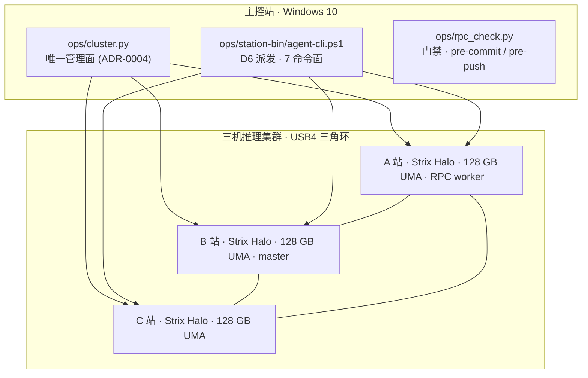

<div align="center">

# RPC

**三机本地推理集群 · Spec-Driven Agent 协议框架**
*A three-node local inference cluster & a spec-driven agent protocol framework*

[](LICENSE)
[](https://www.python.org/)
[](https://learn.microsoft.com/powershell/)
[](https://github.com/ggml-org/llama.cpp)
[](adr/ADR-0004-统一管理入口为唯一管理面.md)
[](#三机推理集群)
[](#设计原则)
[](spec/d6-agent-standard/ARCHITECTURE.md)
[](docs/三机推理集群使用手册.md)

**[English](#english) · [中文](#中文)**

</div>

---

## English

### Overview

`RPC` is a **single-operator** framework that runs a **three-node local LLM inference cluster**
(AMD Ryzen AI Max+ 395 / Strix Halo / `gfx1151`, **128 GB unified memory per node**) over a
**USB4 triangle ring**, and layers a **spec-driven agent protocol** on top of it. Everything here is
built to answer one question: *how do you know that what you produced is real?*

It has three layers, each with a single source of truth:

| Layer | Single face | Role |
|---|---|---|
| Engine | `ops/cluster.py` (ADR-0004) | Load / unload / route / versions / containers across stations |
| Agent (D6) | `ops/station-bin/agent-cli.ps1` | Task cards → dispatch → collect → verify (7 command faces) |
| Gates | `ops/rpc_check.py` via `ops/rpc.ps1 check` | ~50 assertions, run as **pre-commit / pre-push** hooks |

### At a glance

- **3 nodes**, USB4 triangle (A↔B, B↔C, C↔A), MTU 9000, one `/24` per segment.
- **Engine:** llama.cpp (Vulkan + RPC) for distributed inference; single-node **HIP (ROCm)** locally.
  Distributed split is **`-sm layer`** — tensor split (`-sm tensor`) is a **no-go** on this fabric.
- **Zero self-loading:** nothing starts on boot; engines are loaded explicitly.
- **Agent protocol (D6/D7):** 7 command faces, carried by **three envelopes**
  (`TaskContract` / `RunReport` / `Verdict`) and a **D7 six-phase** lifecycle.
- **Sensitivity routing:** `local-only` cards are hard-routed away from any egress model.
- **Evidence chain:** append-only, with an **off-machine anchor** so a rewrite of the archive is detectable.

### Topology



### Design principles

- **One face per concern.** Each layer exposes exactly one entry point; there is no second way to do the same thing.
- **A source of truth, then a derived view.** Facts live in `inventory/*.yaml`; documents and mirrors are *derived* and checked against them.
- **A predicate must be able to fail.** Every gate ships with a *pre-red* case proving it is not vacuous (i.e. that it can actually go red).
- **Fail-closed, never fail-open.** Unknown state is rejected, not assumed. No silent downgrade.
- **Local-first.** Data stays on the ring unless explicitly routed out; `sensitivity` decides.

### Repository layout

| Path | Contents |
|---|---|
| `ops/` | Control face (`cluster.py`), gates (`rpc_check.py`), wrapper (`station-bin/agent-cli.ps1`) |
| `inventory/` | Machine-readable sources of truth (`*.yaml` — ports, models, projects, memory-gates, …) |
| `spec/` | Design docs per subsystem (D6 agent standard, infer-load, rpc-optimization, upstream-tracker, …) |
| `adr/` | Architecture Decision Records (ADR-0001 … ADR-0014) |
| `docs/` | Operator manual, dev logs, research notes |
| `tests/` | Python test suite (one entry point) + offline PowerShell golden fixture |
| `inbox/` | Cross-project intake area (task packages, state machine) |

### Quickstart

```powershell
# Gates: run everything (includes the three stations); -Quick is the local, fast subset
ops\rpc.ps1 check
ops\rpc.ps1 check -Quick
ops\rpc.ps1 check -List                 # list all assertions + their remediation hints

# Cluster: load / inspect / unload an engine across the stations
python ops\cluster.py load <alias> --sm layer
python ops\cluster.py versions
python ops\cluster.py unload

# Agent: dispatch a task card to a station, then review it (advisory)
ops\station-bin\agent-cli.ps1 task   <proj> --card <task.md>
ops\station-bin\agent-cli.ps1 review <proj> -Card <task.md> -Model <judge-alias>
```

### Quality gates

`ops/rpc_check.py` is the single gate implementation; `ops/rpc.ps1` is only its shell. Assertions have
two severities of failure (**FAIL** blocks the commit / push; **WARN** is reported, not blocking), and each
assertion carries its own remediation hint (`check -List`). The suite runs as **pre-commit** (quick subset)
and **pre-push** (full, includes the ring). Nothing is hardcoded twice: a mirror gate *recomputes* identities
rather than trusting declared strings.

### Status & honest scope

- **Active**, single-operator, ~14 ADRs and a large spec/decision record. Open items are enumerated in a
  single ledger — see [OPEN-ISSUES.md](spec/d6-agent-standard/OPEN-ISSUES.md); counts are never duplicated
  in prose (read the ledger, don't read a summary of it).
- **Not** a product or a library: it is an operator's toolchain, tuned for one specific three-node ring.
- Limits are documented as limits: tensor-parallel across the ring is a **no-go**; some upstream model
  architectures are not yet supported by the engine (tracked in `spec/upstream-tracker/TRACKER.md`).

### Start here

- [Operator manual (使用手册)](docs/三机推理集群使用手册.md) — commands, topology, exit codes
- [ARCHITECTURE.md](spec/d6-agent-standard/ARCHITECTURE.md) — current system boundary (§1a)
- [OPEN-ISSUES.md](spec/d6-agent-standard/OPEN-ISSUES.md) — the single ledger of open items
- [ADR-0004](adr/ADR-0004-统一管理入口为唯一管理面.md) — single management face
- [Upstream tracker](spec/upstream-tracker/TRACKER.md) — engine PR/issue status

### License

MIT © 2026 StormstoutLau — see [LICENSE](LICENSE).

---

## 中文

### 概览

`RPC` 是一套**单人维护**的框架：在 **USB4 三角环**上运行一个**三机本地大模型推理集群**
（AMD Ryzen AI Max+ 395 / Strix Halo / `gfx1151`，**每站 128 GB 统一内存**），并在其上叠加一层
**spec 驱动的 Agent 协议**。它的一切都围绕一个问题：*你凭什么知道你产出的东西是真的？*

它分三层，每层只有**一个**入口：

| 层 | 唯一面 | 职责 |
|---|---|---|
| 引擎层 | `ops/cluster.py`（ADR-0004） | 跨站加载 / 卸载 / 路由 / 版本 / 容器 |
| Agent 层（D6） | `ops/station-bin/agent-cli.ps1` | 任务卡 → 派发 → 回收 → 复核（7 个命令面） |
| 门禁层 | `ops/rpc_check.py`（经 `ops\rpc.ps1 check`） | ~50 项断言，作为 **pre-commit / pre-push** 钩子运行 |

### 一屏

- **三站**：USB4 三角环（A↔B、B↔C、C↔A），MTU 9000，每段独占一个 `/24`。
- **引擎**：分布式走 llama.cpp（Vulkan + RPC）；单机走 **HIP（ROCm）**。
  分布式切分**只走 `-sm layer`** —— 张量切分（`-sm tensor`）在本链路是 **No-Go**。
- **零自加载**：开机不启任何推理服务，引擎一律显式加载。
- **Agent 协议（D6/D7）**：7 个命令面，由**三信封**（`TaskContract` / `RunReport` / `Verdict`）
  与 **D7 六相**生命周期承载。
- **敏感路由**：`local-only` 的卡被硬路由挡在任何出网模型之外。
- **证据链**：append-only，并配**机外锚**，使整链被回写可被发现。

### 拓扑


### 设计原则

- **一事一面**：每一层只暴露一个入口，同一件事不存在第二条做法。
- **先有真值，再有派生视图**：事实写在 `inventory/*.yaml`；文档与镜像都是**派生**的，并与真值对账。
- **判据必须命得中**：每条门禁都配一条**先验红**用例，证它**不是恒真**（真能判红）。
- **fail-closed，不 fail-open**：未知状态一律**拒**，不假设、不静默降级。
- **本地优先**：数据默认不出环；是否出网由 `sensitivity` 决定。

### 目录结构

| 路径 | 内容 |
|---|---|
| `ops/` | 控制面（`cluster.py`）、门禁（`rpc_check.py`）、派发壳（`station-bin/agent-cli.ps1`） |
| `inventory/` | 机读真值（`*.yaml` —— 端口、模型、项目注册表、记忆门禁 …） |
| `spec/` | 各子系统设计（D6 agent 标准、infer-load、rpc-optimization、upstream-tracker …） |
| `adr/` | 架构决策记录（ADR-0001 … ADR-0014） |
| `docs/` | 操作手册、开发日志、调研笔记 |
| `tests/` | Python 测试套件（统一入口）+ PowerShell 离线黄金夹具 |
| `inbox/` | 跨项目受理区（任务转运包、状态机） |

### 快速开始

```powershell
# 门禁：全量（含三站 ssh）· -Quick 为本地快检
ops\rpc.ps1 check
ops\rpc.ps1 check -Quick
ops\rpc.ps1 check -List                 # 列全部断言 + 各自的处置建议

# 集群：跨站加载 / 查态 / 卸载
python ops\cluster.py load <alias> --sm layer
python ops\cluster.py versions
python ops\cluster.py unload

# Agent：把任务卡派发到某站，再复核（advisory）
ops\station-bin\agent-cli.ps1 task   <proj> --card <task.md>
ops\station-bin\agent-cli.ps1 review <proj> -Card <task.md> -Model <judge-alias>
```

### 门禁

`ops/rpc_check.py` 是门禁的**唯一实现**，`ops\rpc.ps1` 只是它的外壳。断言分两级失败：
**FAIL** 会阻断提交 / 推送；**WARN** 只如实报出、不阻断。每条断言自带处置建议（`check -List`）。
套件在 **pre-commit**（快检）与 **pre-push**（全量，含环链路）两处运行。**同一事实绝不两处定义**：
镜像门禁**复算**身份，而不是采信声明出来的串。

### 状态与诚实射程

- **活跃中**，单人维护，约 14 份 ADR 与大量 spec/决策记录。未决项**只在一处枚举** ——
  见 [OPEN-ISSUES.md](spec/d6-agent-standard/OPEN-ISSUES.md)；**计数不在散文里重复**
  （要读就读台账本身，别读它的摘要）。
- **不是**产品、也不是库：它是一位运维者的工具链，针对这一套特定的三机环调优。
- 边界如实写在文档里：跨环张量并行是 **No-Go**；部分上游模型架构引擎尚未支持
  （跟踪见 `spec/upstream-tracker/TRACKER.md`）。

### 从这里开始

- [操作手册](docs/三机推理集群使用手册.md) —— 命令、拓扑、退出码
- [ARCHITECTURE.md](spec/d6-agent-standard/ARCHITECTURE.md) —— 现行系统边界（§1a）
- [OPEN-ISSUES.md](spec/d6-agent-standard/OPEN-ISSUES.md) —— 未决项的单一台账
- [ADR-0004](adr/ADR-0004-统一管理入口为唯一管理面.md) —— 唯一管理面
- [上游跟踪台账](spec/upstream-tracker/TRACKER.md) —— 引擎 PR/Issue 状态

### 许可

MIT © 2026 StormstoutLau —— 见 [LICENSE](LICENSE)。

---

<div align="center">
<sub>Built for one question: <b>how do you know that what you produced is real?</b> · 为一个问题而建：<b>你凭什么知道你产出的东西是真的？</b></sub>
</div>
